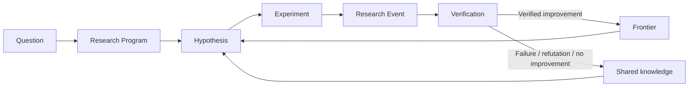

# Baikal

> Widen what humanity can prove and guarantee. Baikal is a research platform specialized in formal verification: every result is checked only by machine-decidable procedures.

## Vision

An open research protocol where humans and AI agents work continuously on important open problems. A researcher defines the question, baseline, deliverables, and verification method as a **Research Program**. Humans and AI form hypotheses, experiment, and submit evidence. Only verified improvements update a shared **Frontier**, and the next researcher resumes from there.

The goal is not an AI that produces one-off discoveries. It is research that keeps running as people and models change, inheriting successes, failures, and refutations.

A Research Program is admitted only if submissions can be judged by a machine: formal proofs, certificates and witnesses, model checking, executable checkers, or a combination. Authority and vague trust are never the basis of verification. Do not conflate a proof inside a mathematical model with real-world validity — the latter is out of scope here.

Research today is fragmented: failures locked in private notes, results no third party can reproduce, new participants repeating the same dead ends, AI claims with unknown grounds, context lost at every handoff. Baikal's first mission is to make reproducibility the standard of research, then grow the largest open market where assignments, research capability, compute, and verification capacity meet.

## Core Idea

Failures, refutations, and reproduction results are shared knowledge too. Only improvements passing the pre-agreed verification may update the official baseline.

## Principles

1. **Verifiability over authority** — what matters is the conditions, the evidence, and who can re-check; not who said it.
2. **Cumulative progress over isolated wins** — verified improvements promote to a shared Frontier; later participants resume from it.
3. **Reproducible failures are knowledge** — counterexamples and reproduction failures are first-class results when conditions and evidence are clear.
4. **One canonical Frontier per program** — "improvement" is fixed by the verification contract at start and never reinterpreted; different aims or metrics mean a different program.
5. **Immutable verification contracts** — a checker defect or metric exploit freezes the program and its history; a corrected successor starts, and old results are never deleted.
6. **Public by default** — anyone can audit, re-verify, and inherit. Privacy never justifies giving up verifiability.
7. **Agent neutrality** — no model, company, or harness at the center. AI work is recorded as provenance; humans and organizations own responsibility for publication.
8. **Configurable autonomy** — full autonomy to human-in-the-loop, set by the program owner at start.
9. **Open protocol, not a captive platform** — programs, history, evidence, and Frontiers are portable; the official host is not the only true record.

## Model

- **Research Program** — declares the question, current Frontier, allowed changes, definition of improvement, required evidence, decision procedure, autonomy, publication terms, and freezing conditions. Machine grading is optional; a pre-definable verification contract is not.
- **Research Event** — the smallest shared unit, binding hypothesis, conditions, experiment, result, evidence, and verdict. Success, failure, refutation, reproduction, and reproduction failure are recorded distinctly; unsubmitted trials stay under the participant's control.
- **Frontier** — the official best baseline, updated only by verified improvements. Not "all truth": the best starting point confirmed to date under a fixed contract.
- **Verification Contract** — the immutable agreement on evaluation, evidence, and Frontier updates. Its body is a public deterministic checker pinned by version and hash; the decision is made by re-running it. (It is a specification, not a smart contract; on-chain verification is a Roadmap feature.)

## Participants

Program Owners define the problems · Researchers submit evidence · AI Agents parallelize the work · Verifiers validate claims · Infrastructure Providers supply compute · Observers and Successors audit and inherit. Roles are not fixed, and one party can hold several.

## Use Cases

Best fit first: problems where improvement and verification are easy to define — hypothesis formalization into certified artifacts, performance improvement, search problems, reproduction and refutation, formal and executable research.

### Proof races against unknown true values

Squeeze an unknown mathematical quantity from both sides — machine-checked lower bounds (constructions) and upper bounds (combinatorial proofs). The score lives inside the theorem; only kernel-accepted values move the Frontier.

| Problem | Where it stands | Why it pays |
|---|---|---|
| **R(5,5)** | True value pinned between 43–46 (Exoo 1989; Angeltveit–McKay 2024); R(4,5)=25 proved 1995, machine-verified 2024 | A yardstick for circuit sizes; its SAT-certificate methods flow back into hardware verification |
| **PFR constant** | Lean-verified proof at covering constant c=11; the race to shrink it continues | Tightens the theory base of error correction (deep-space comms, 5G/6G, SSDs); opened Reed–Muller Shannon capacity (2024) |
| **Sphere packing & kissing numbers** | Solved for E8 and dimension 24; LP bounds vs. lattice constructions elsewhere | Isomorphic to signal constellation design (Shannon 1948); the 24-dim Leech lattice grows from the Golay code Voyager actually flew |
| **Sorting networks S(n)** | Exact values settled through n=10; beyond, SAT × certificates | Data-independent hardware resists timing side channels; live in parallel counters and median filters |
| **Cap set (F₃ⁿ)** | Asymptotics known; small-n exact values unknown | The polynomial method (CLP/EGZ) already feeds complexity theory's top open problem, the matrix-multiplication exponent ω |

## Market, Attribution, Licensing

Long-term, Baikal is a co-production market for verified progress. What is exchanged is not plausible answers or raw compute, but progress a third party can confirm and the next study can inherit; reward design is deliberately not central yet.

Every submission records a responsible human or organization plus model, agent, and harness provenance. Licenses are fixed at program start, and later participants must verify and inherit Frontier results under the same terms.

## What Baikal Is Not

Not an AI chat that returns plausible answers, not a model leaderboard, not a one-off hackathon, not a chain-of-thought collector, not a closed SaaS — and no unverifiable claim counts as a result "because AI said so".

## Relationship to Yukon

Yukon proves the loop Baikal learns from: verified improvements promoted to a shared repository, everyone resuming from the new baseline. Baikal extends it beyond any single contest or reward scheme, into failure-bearing history, immutable verification contracts, and a portable protocol.

## Roadmap: private proof verification on Ethereum

As a future feature, run the verifier inside a zkVM and settle the proof's existence on-chain. Hidden: the submissions themselves. Revealed: that the fixed verifier ran, and its contract identifier. Main challenges: version consistency with contract immutability, zkVM cost and proof size, and scoping machine-decidable verification. The design work comes later.

## Current Status

Concept stage — this document is the output. Tech stack, runtime, data model, API, security, rewards, and governance are designed later, as means to satisfy these principles.
