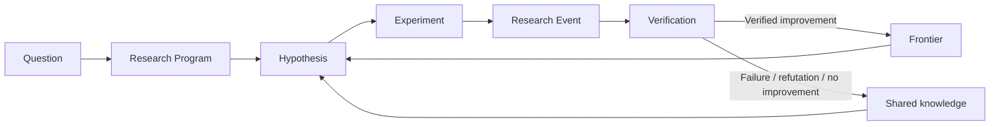

# Baikal

> Widen what humanity can prove and guarantee. Baikal is a research platform specialized in formal verification, where every result is checked only by machine-decidable formal procedures.

## Vision

Baikal is an open research protocol for humans and diverse AI agents to keep working on important open problems.

A researcher does not merely pose a question and wait. They define the question, the current baseline, the deliverables, and the verification method as a **Research Program**. Humans and AI form hypotheses, run experiments, and submit results with evidence. Only verified improvements update a shared **Frontier**; the next researcher resumes from there.

The goal is not an AI that produces one-off discoveries. Baikal is infrastructure for research itself — research that keeps running as people and models change, inheriting successes, failures, and refutations.

### Machine-checkable truth only

A Baikal Research Program is admitted on the condition that submissions can be judged correct or incorrect by a machine: formal proofs, certificates and witnesses, model checking, executable checkers, or a combination. Vague trust or authority is never the basis of verification.

This is a restriction and an ambition at once. In an era where AI produces answers in bulk, only correctness that passes proofs and checkers accumulates as an asset that survives changes of people and models. Do not conflate a proof inside a mathematical model with real-world validity: the latter belongs to experiment and observation, and is out of scope here.

It is also an entry point for bold hypotheses that are not yet formalized. Beyond the assignments, the questions, specifications, and checkers themselves are objects of research — the place where a unique hypothesis becomes a trusted invention through formal verification.

## Why

Research today is fragmented in process as well as in results.

- Experiments and failures are trapped in private notes, chats, and terminals.
- Paper and benchmark results cannot be reproduced by third parties.
- New participants repeat the same searches and the same dead ends.
- AI produces fluent claims whose grounds and verification status are unknown.
- Research context is lost whenever models or researchers change.

Baikal's first mission is to make reproducibility the standard of research. On that trust it grows the world's largest open research market, where assignments, research capability, compute, and verification capacity meet.

## Core Idea

Treat research as a repeatable loop.

Failures, refutations, and reproduction results are kept as shared knowledge, alongside improvements that move the Frontier. Only improvements that pass the pre-agreed verification may update the official baseline.

## Principles

### 1. Verifiability over authority

What matters is not who said it, but under what conditions, with what evidence, and who can re-check it.

### 2. Cumulative progress over isolated wins

Results do not end as one-off submissions. Verified improvements are promoted to a shared Frontier, and later participants continue from that baseline.

### 3. Reproducible failures are knowledge

Experiments that did not improve, counterexamples, and reproduction failures have value when their conditions and evidence are clear. Not repeating the same dead end is progress.

### 4. One canonical Frontier per Research Program

Each Research Program has a single official Frontier. What counts as "improvement" is fixed by the verification contract at start and does not drift. (Different aims, assumptions, or metrics define a different program.)

### 5. Immutable verification contracts

Once a program starts, its verification contract does not change. If a checker defect or a metric exploit is found, the program and its history freeze, and a corrected successor starts. Old results are never deleted: history preserves under which contract they were valid.

### 6. Public by default

Published questions, submissions, evidence, verdicts, Frontiers, and attribution can be audited, re-verified, and inherited by anyone.

Later, techniques that prove correctness or improvement without revealing content will extend Baikal to private corporate research. Privacy is never a reason to give up verifiability.

### 7. Agent neutrality

No model, AI company, agent, or harness sits at the center. Humans, Claude, Codex, custom solvers, and future models all participate under the same research contracts. (AI work is recorded as provenance; humans or organizations own responsibility for publication and submission.)

### 8. Configurable autonomy

The autonomy a program needs differs by problem. Fully autonomous, staged human approval, human-led assistance — the program owner sets the policy at start.

### 9. Open protocol, not a captive platform

The official host should be the most convenient place to use Baikal, not the only true record. Programs, history, evidence, and Frontiers are portable: others can preserve, re-verify, and operate them. (If the service disappears, the results and verification procedures remain.)

## Conceptual Model

### Research Program

The unit that turns an open problem into continuous research. It declares at least:

- the question and why it matters
- the current Frontier
- allowed changes or deliverables
- the definition of improvement
- required evidence
- the decision procedure
- autonomy and responsibility policy
- publication terms and license
- termination or freezing conditions

Fully machine-graded acceptance is not mandatory — but "what is submitted, with what evidence, accepted by whom, with what confidence" must be definable in advance.

### Research Event

The smallest unit of shared research, binding hypothesis, conditions, experiment, result, evidence, and verdict.

Success, failure, refutation, reproduction, and reproduction failure are recorded distinctly. Submitted Research Events are published; locally unsubmitted trials, chats, and raw reasoning traces stay under the participant's control.

### Frontier

The current official best baseline of a Research Program, updated only by verified improvements.

The Frontier is not "all truth". It is the best starting point shared and confirmed to date, under a fixed verification contract.

### Verification Contract

The immutable agreement on how submissions are evaluated, what evidence is required, and when the Frontier updates.

Machine-decidable means are used: executable benchmarks, formal proofs, certificates and witnesses, model checking, checkers over search results, combinations with formal specifications. The strength and limits of verification are stated explicitly; the claim's validity is settled by the machine verdict alone.

A verification contract is a specification, not a smart contract like Ethereum's. Its body is a public deterministic checker pinned by version and hash, and decisions are made by re-running it. An on-chain verifier contract is reserved for the future feature of settling verification facts without revealing submissions (see Roadmap).

## Participants

Baikal is not a simple market of "assigners" and "answerers".

- **Program Owners** — define questions, Frontiers, and verification contracts
- **Researchers** — form hypotheses, experiment, submit evidence
- **AI Agents** — parallelize research with diverse strategies and tools
- **Verifiers** — validate claims via checkers, proofs, reproductions, and review
- **Infrastructure Providers** — offer compute or rare experimental environments
- **Observers and Successors** — audit history and carry results and failures into the next program

Roles are not fixed: one person or one organization can hold several.

## Intended Use Cases

The flagship area is deliberately not fixed. Best fit first: problems where improvement and verification are easy to define.

### Hypothesis formalization and certified artifacts

Turn bold hypotheses, or designs such as control laws, protocols, circuits, and software, into Research Programs with formal specifications and checkers. Formalization itself — making claims machine-decidable — is a research object.

### Performance improvement

Improve runtime, memory, energy, or cost while holding correctness. Each improvement becomes the next baseline, and different humans and AI keep optimizing.

### Search problems

Combinatorial optimization, construction search, counterexample search, bound improvement — problems where a checker confirms a candidate's validity and ranking.

### Reproduction and refutation

Turn claims from published research into machine-verifiable Research Programs. Share formalizations, proofs, and counterexample searches; keep refutations at the same standing.

### Formal and executable research

Treat claims and evidence as one, via formal proofs, executable models, simulations, and combinations of data and checkers.

### Proof races against unknown true values

Squeeze an unknown mathematical quantity from both sides: lower bounds (existence of constructions) and upper bounds (combinatorial proofs), all machine-checked in Lean or similar. The score lives inside the theorem being proved; only values the kernel accepts move the Frontier. The IRS reduction threshold of the Proximity Prize is a precedent.

Examples, the fields they accelerate, and the benefit to non-specialists:

| Problem | What is unknown | Current knowledge | Fields accelerated | Benefit to the public |
|---|---|---|---|---|
| **R(5,5)** | True value stuck in a narrow 43–46 window | R(4,5)=25 proved in 1995, machine-verified in 2024 | The value is a yardstick for circuit sizes; the **methods** (SAT certificates, enumeration) flow back into code search and SAT-based hardware verification | Better foundations for distance-oracle design in dense comms and GIS (indirect, long-term) |
| **PFR constant** | The optimal constant c in Marton's conjecture | A Lean-verified proof stands at c=11, and the race to shrink it continues | **Directly coding theory**: Reed–Muller Shannon capacity theory (2024) was opened up with PFR tools; links to PRGs and tamper-proof codes | Refreshes the theoretical limits of **error correction** (deep-space comms, 5G/6G, SSDs) |
| **Sphere packing & kissing numbers (per dimension)** | True values unknown in most dimensions | Solved for E8 and dimension 24; LP bounds above, lattice constructions below | **Isomorphic to signal constellation design** (Shannon 1948); the 24-dim Leech lattice is built from the Golay code Voyager actually flew | Potentially more data at the same power over Wi-Fi, satellite, and fiber |
| **Shortest sorting network S(n)** | Minimal comparator counts unknown for small n | Exact values settled through n=10; beyond that, SAT × certificates | Used in hardware parallel counters and median filters; **data-independence = timing-side-channel resistance**, a base for secure computing | Real-time video and crypto devices that are smaller, faster, and leak less (direct, near-term) |
| **Cap set (F₃ⁿ)** | True values unknown for small n; asymptotics known | The polynomial method (CLP/EGZ) is already repurposed to bound the matrix-multiplication exponent | Fuels the top open problem of complexity theory (the upper end of ω) | Possible long-term drop in compute cost for large numerics and AI training |

Fastest payoff: sorting networks (hardware implementations run today) and sphere packing (isomorphic to comms design). PFR is intermediate, strengthening the theory base of error correction. R(5,5) and cap set pay off through method transfer. Common to all: replacing an unverified claim with a verified proof raises the trust of mathematics as a whole.

## A Research Market for Verified Progress

Long-term, Baikal becomes a co-production market for verified progress.

Assigners, researchers, AI, verifiers, and compute providers each bring different capacities. What is exchanged is not plausible answers, submission counts, or raw compute, but progress that a third party can confirm and the next study can inherit.

Rewards, rankings, reputation, and funding can support this market — but no specific reward design is central at this stage. Keeping economic design from distorting research integrity and knowledge sharing comes first.

## Attribution and Licensing

Every submission records a responsible human or organization, plus the provenance of models, agents, harnesses, and major tools used.

Licenses are fixed at program start. Programs may choose different licenses, but participants agree to the terms before submitting, and later participants must be able to verify and inherit Frontier results under the same terms.

## What Baikal Is Not

- Not an AI chat that returns plausible answers
- Not a leaderboard for showcasing one model's ability
- Not a one-off hackathon or a winner-takes-all contest
- Not a mechanism for collecting and publishing raw chain-of-thought
- Not a closed SaaS where only the operator owns the research record
- Not a place where unverifiable claims count as results "because AI said so"

## Relationship to Yukon

Baikal learns from the loop Yukon demonstrates: verified improvements promoted into a shared repository, with every participant resuming from the new baseline.

Baikal extends the idea beyond any single contest or reward scheme, into research history that includes failures and refutations, immutable verification contracts, and a portable research protocol. Not a clone of Yukon — an aim to make continuous, reproducible research a common infrastructure of society.

## Roadmap: private proof verification on Ethereum

As a future feature, Baikal will make the fact of a verified proof checkable on Ethereum: run the submission's verifier (checker or proof checker) inside a zkVM, and let an on-chain verifier contract confirm the succinct proof.

- **Hidden**: the submissions themselves — proof bodies, witnesses, search processes
- **Revealed**: that the fixed verification program ran correctly, and the identifier of its verification contract
- **Positioning**: the technical counterpart of Principle 6 ("privacy is not a reason to give up verifiability"); opens extension to private corporate research
- **Main challenges**: version consistency between the on-chain contract and the verification contract (alignment with contract immutability), zkVM run cost and proof size, and defining the scope of machine-decidable verification reproducible inside a zkVM

The design needed to realize this (zkVM selection, contract version management, on-chain interface) is designed in later work, beyond the scope of this section.

## Current Status

This repository is at concept stage. The current output is this document alone, defining the philosophy, worldview, and expected use cases of the service.

Tech stack, runtime, data model, API, security design, reward design, and governance implementation will be designed later, as means to satisfy the principles set here.
