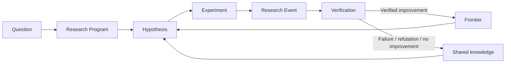

# Auto Research

> AI によって研究が加速する世界では、成果を誰もが検証できることがこれまで以上に重要になる。Auto Research は、その世界に必要な検証可能な研究基盤をつくるためのプロジェクトである。

## Vision

Auto Research は、人間と多様な AI エージェントが、重要な未解決問題に継続的に取り組むためのオープンな研究プロトコルである。

研究者は、問いを投げて回答を待つのではない。問い、現在の基準、提出物、検証方法を **Research Program** として定義する。人間や AI は仮説を立て、実験し、結果と証拠を提出する。検証済みの改善だけが共有された **Frontier** を更新し、次の研究者はその地点から再開する。

目指すのは、一度きりの発見を生む AI ではない。人やモデルが交代しても止まらず、成功・失敗・反証を継承しながら進み続ける研究そのものの基盤である。

## Why

現在の研究は、成果だけでなく過程も断片化している。

- 実験条件や失敗が個人のノート、会話、端末に閉じ込められる
- 論文やベンチマークの結果を第三者が再現できない
- 新しい参加者が、過去と同じ探索や失敗を繰り返す
- AI が流暢な主張を生成しても、その根拠と検証状態が分からない
- モデルや研究者が変わるたびに、研究の文脈が失われる

Auto Research の第一の使命は、研究の再現性を標準にすることである。その信頼の上に、課題、研究能力、計算資源、検証能力が出会う世界最大の公開研究市場を育てる。

## Core Idea

研究を、次の反復可能なループとして扱う。

Frontier を進めた成果だけでなく、提出された失敗、反証、再現結果も共有知として残す。ただし、公式の基準を更新できるのは、あらかじめ合意された検証を通過した改善だけである。

## Principles

### 1. Verifiability over authority

誰が主張したかではなく、どの条件で、どの証拠により、誰が再検証できるかを重視する。

### 2. Cumulative progress over isolated wins

研究成果を単発の提出で終わらせない。検証済みの改善を共有 Frontier へ昇格し、後続の参加者がその成果を基準として研究を続ける。

### 3. Reproducible failures are knowledge

改善しなかった実験、反例、再現失敗も、条件と証拠が明確なら価値がある。同じ行き止まりを繰り返さないことも研究の進歩である。

### 4. One canonical Frontier per Research Program

各 Research Program は、単一の公式 Frontier を持つ。何が「改善」であるかは開始時の検証契約によって決まり、途中で意味を変えない。

(異なる目的、仮定、指標を扱いたい場合は、別の Research Program として定義する)

### 5. Immutable verification contracts

Research Program の開始後、検証契約は変更しない。checker の欠陥や指標の攻略が判明した場合、既存プログラムと履歴を凍結し、修正版を後継プログラムとして開始する。

旧成果は削除しない。「どの契約の下で正当だったか」を履歴として保持する。

### 6. Public by default

公開された問い、提出、証拠、判定、Frontier、帰属は、誰でも監査・再検証・継承できることを標準とする。

将来は、内容を明かさずに正しさや改善を証明する技術を用い、企業や組織の非公開研究にも拡張する。秘匿性は検証可能性を捨てる理由にしない。

### 7. Agent neutrality

特定のモデル、AI 企業、エージェント、ハーネスを研究の中心に置かない。人間、Claude、Codex、独自 solver、将来のモデルが、同じ研究契約の下で参加できる。

(AI は provenance として記録し、公開・提出に対する責任は人間または組織が負う)

### 8. Configurable autonomy

研究に必要な自律性は課題ごとに異なる。完全自律、段階的な人間承認、人間主導の補助など、Research Program の所有者が開始時に方針を定める。

### 9. Open protocol, not a captive platform

公式ホストは、Auto Research を利用する最も便利な場所であるべきだが、唯一の正史にはならない。研究プログラム、履歴、証拠、Frontier は移植可能であり、別の主体が保存・再検証・運営できるべきである。

(運営サービスが消えても、研究成果と検証手順は残る)

## Conceptual Model

### Research Program

未解決問題を継続的な研究対象へ変換する単位。少なくとも次を宣言する。

- 問いと、その重要性
- 現在の Frontier
- 許される変更または提出物
- 改善の定義
- 必要な証拠
- 判定手続き
- 自律性と責任の方針
- 公開条件とライセンス
- 終了または凍結条件

完全自動採点は必須ではない。ただし、「何を提出し、どの証拠で、誰が、どの確度として認めるか」という検証契約を事前に定義できなければならない。

### Research Event

共有される研究の最小単位。仮説、条件、実験、結果、証拠、判定を結びつける。

成功、失敗、反証、再現、再現失敗を区別して記録する。提出された Research Event は公開する一方、非提出のローカル試行、会話、生の推論トレースは参加者の管理下に置く。

### Frontier

Research Program における、現在の公式な最良基準。検証済みの改善によってのみ更新される。

Frontier は「真理のすべて」ではない。それは、固定された検証契約の下で、現時点までに共有・確認された最良の出発点である。

### Verification Contract

提出物をどのように評価し、どの証拠を要求し、どの条件で Frontier を更新するかを定める不変の契約。

実行可能な benchmark、形式証明、探索結果の checker、再現実験、事前定義された人間審査などを利用できる。検証の強さと限界は明示し、機械的検証と専門家判断を同じ確度として扱わない。

## Participants

Auto Research は、単純な「課題の出題者」と「回答者」の市場ではない。

- **Program Owners** — 問い、Frontier、検証契約を定義する
- **Researchers** — 仮説を形成し、実験し、証拠を提出する
- **AI Agents** — 多様な戦略とツールで研究を並列化する
- **Verifiers** — checker、証明、再現実験、審査を通じて主張を検証する
- **Infrastructure Providers** — 計算資源や特殊な実験環境を提供する
- **Observers and Successors** — 履歴を監査し、成果と失敗を次の研究へ継承する

これらの役割は固定ではない。一人または一つの組織が複数の役割を担うこともできる。

## Intended Use Cases

初期の旗艦領域はまだ固定しない。最初に適しているのは、改善と検証を明確に定義しやすい課題である。

### Performance improvement

正しさを維持しながら、処理時間、メモリ、消費電力、コストなどを改善する。各改善が次の baseline となり、異なる人間や AI が継続して最適化する。

### Search problems

組合せ最適化、構成探索、反例探索、境界改善など、候補の妥当性と優劣を checker で確認できる問題に取り組む。

### Reproduction and refutation

公開研究の主張を再実験可能な Research Program に変換する。再現できた条件だけでなく、再現できなかった条件や反例も共有する。

### Formal and executable research

形式証明、実行可能モデル、シミュレーション、データと checker の組み合わせにより、主張と証拠を一体として扱う。

## A Research Market for Verified Progress

長期的には、Auto Research を「検証済み進歩の共同生産市場」にする。

課題所有者、研究者、AI、検証者、計算提供者が、それぞれ異なる能力を持ち寄る。交換される価値は、もっともらしい回答でも、提出回数でも、計算時間そのものでもない。第三者が確認し、次の研究が継承できる進歩である。

報酬、ランキング、評判、資金配分は、この市場を支える手段になり得る。ただし、現段階では特定の報酬設計を中核に置かない。経済設計が研究の誠実さや知識共有を歪めないことを優先する。

## Attribution and Licensing

すべての提出は、人間または組織の責任主体と、利用したモデル、エージェント、ハーネス、主要ツールの provenance を記録する。

ライセンスは Research Program の開始時に固定する。プログラムごとに異なるライセンスを選べるが、参加者は提出前にその条件へ同意し、Frontier に昇格した成果を後続の参加者が同じ条件で検証・継承できなければならない。

## What Auto Research Is Not

- もっともらしい回答を返すだけの AI チャットではない
- 特定モデルの能力を示すためだけの leaderboard ではない
- 一度きりの hackathon や winner-takes-all の競技ではない
- 生の chain-of-thought を収集・公開するための仕組みではない
- 運営者だけが研究記録を所有する閉じた SaaS ではない
- 検証できない主張を「AI が言ったから」という理由で成果にする場所ではない

## Relationship to Yukon

Yukon が示す「検証済み改善を共有リポジトリへ昇格し、全参加者が新しい baseline から再開する」という累積的研究ループから学ぶ。

Auto Research は、その考え方を特定の競技や報酬制度に閉じず、成功・失敗・反証を含む研究履歴、変更不能な検証契約、移植可能な研究プロトコルへ広げる。Yukon の複製ではなく、継続的で再現可能な研究を社会の共通インフラにすることを目指す。

## Current Status

このリポジトリは構想段階にある。現在の成果物は、サービスの哲学、世界観、想定ユースケースを定義する本文書のみである。

技術スタック、実行基盤、データモデル、API、セキュリティ設計、報酬設計、ガバナンス実装は、ここで定めた原則を満たすための手段として今後設計する。
